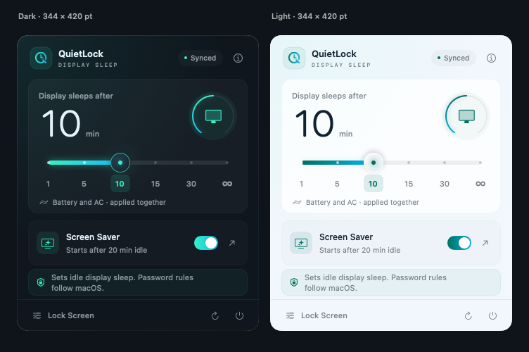
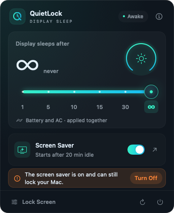
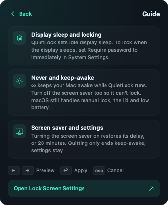

<div align="center">


# QuietLock

**A native macOS menu bar utility for display sleep and the screen saver.**

Set when your Mac's display goes to sleep — 1, 5, 10, 15, 30 minutes or never — with a single slider, and switch the automatic screen saver on or off, right from the menu bar.

[](https://github.com/tianguzhe/QuietLock/releases/latest)


**English** | [简体中文](README_CN.md)

[**⬇ Download the latest DMG**](https://github.com/tianguzhe/QuietLock/releases/latest/download/QuietLock.dmg)



</div>

## Features

- **Six-step slider** — 1, 5, 10, 15, 30 minutes or ∞ (never). Drag with live preview and haptic detents, or click a tick to apply.
- **Applies to every power source** — battery, AC and supported UPS profiles are set together, then read back and verified.
- **Never means never** — choosing ∞ also holds a native keep-awake assertion while QuietLock runs.
- **Automatic screen saver switch** — turn the idle screen saver off; turning it back on restores your previous delay.
- **Clear warnings** — if the screen saver could still lock your Mac while display sleep is set to never, the panel says so and offers a one-click fix.
- **Stays in sync** — re-reads the real settings every 15 seconds and on wake or unlock, and reports changes made elsewhere instead of silently overwriting them.
- **Authorize once per launch** — one administrator prompt per launch, no further prompts until you quit.
- **English and Simplified Chinese** — the panel follows your preferred system language: Simplified Chinese shows Chinese; any other language shows English.
- **Native and accessible** — SwiftUI with dark and light appearance, Reduce Motion and Reduce Transparency support, full keyboard control and VoiceOver.
- **No dependencies** — a universal binary built with Apple frameworks only.

## Screenshots

| Never, with a screen saver warning | Built-in guide |
| :---: | :---: |
|  |  |

## Installation

1. Download [`QuietLock.dmg`](https://github.com/tianguzhe/QuietLock/releases/latest/download/QuietLock.dmg) from the [latest release](https://github.com/tianguzhe/QuietLock/releases/latest). A `.sha256` checksum is published alongside it.
2. Open the disk image and drag **QuietLock** into **Applications**.
3. Launch QuietLock from Applications. It lives in the menu bar only and has no Dock icon.

> [!NOTE]
> Release builds are ad-hoc signed and not notarized by Apple. On first launch macOS may block the app: right-click it and choose **Open**, or allow it under **System Settings → Privacy & Security**.

To update, quit the running copy first, then replace it in Applications.

## Usage

1. Click the clock-shaped **Q** icon in the menu bar.
2. **One-time setup:** click **Lock Screen** at the bottom of the panel and set *Require password after screen saver begins or display is turned off* to **Immediately**. QuietLock controls *when* the display sleeps; this system setting controls whether a password is then required.
3. Drag the slider and release, or click a tick. The first change after each launch asks for an administrator password; later changes in the same session apply without a prompt.
4. To avoid idle locking entirely, choose **∞** *and* turn off **Screen Saver**. The screen saver has its own idle timer and can still require a password.

| Key | Action |
| --- | --- |
| <kbd>←</kbd> <kbd>→</kbd> | Preview the previous or next step |
| <kbd>Return</kbd> / <kbd>Space</kbd> | Apply the previewed step |
| <kbd>Esc</kbd> | Cancel the preview |

## How it works

| Control | System setting | Notes |
| --- | --- | --- |
| Time slider | `pmset -a displaysleep <minutes>` | Applied to all power sources, then re-read with `pmset -g custom`. |
| ∞ (never) | `displaysleep 0` + IOKit `PreventUserIdleDisplaySleep` | The assertion prevents idle display and system sleep while QuietLock runs and is released when it quits. |
| Automatic screen saver | `com.apple.screensaver` → `idleTime` (current user, current host) | Writing `0` disables it; the previous delay is saved and restored (20 minutes if none was recorded). Read back after writing. |

- Every write is verified by reading the real value back. A cancelled or partial change shows the actual state and never reports success.
- If another app or System Settings changes display sleep, QuietLock shows the new value and stops keeping the Mac awake instead of fighting the change.
- Settings stay in place after QuietLock quits; only the keep-awake assertion ends.
- **Never** does not prevent manual locking, closing the lid, low-battery sleep or managed policies. Screen saver settings enforced by an organization are shown as managed and cannot be changed.

## Privileges and security

`pmset` must run as root. QuietLock never stores your password and installs no background service.

- **First change after launch:** a standard macOS administrator prompt (`do shell script … with administrator privileges`) applies the change and installs `/etc/sudoers.d/quietlock`. The rule is validated with `visudo -c` and installed as `0440 root:wheel`; if validation fails, the rule is skipped and the change still applies.
- **Scope of the rule:** the current user may run exactly seven commands without a password — `pmset -a displaysleep` with `1`, `5`, `10`, `15`, `30` or `0`, and `rm -f /etc/sudoers.d/quietlock`. Nothing else is allowed. User names containing spaces, quotes, commas or other unsafe characters never get a rule.
- **Later changes:** `sudo -n` (which never prompts). If the rule has been removed, QuietLock asks again.
- **Revocation:** the authorization is remembered in memory only, so every launch asks once. On quit, including logout and shutdown, the rule removes itself. A rule left behind by a crash is removed on the next launch, or manually with `sudo rm /etc/sudoers.d/quietlock`.

> [!IMPORTANT]
> While QuietLock is running (or after a crash until the next launch), any process running as your user can change display sleep to one of the six presets without a password.

## Building from source

Requires macOS 14 or later and Xcode 15 or later. No third-party dependencies.

```sh
bash scripts/test.sh          # unit tests (mocked services; no settings are changed)
bash scripts/build.sh         # universal app → .build/QuietLock.app (ad-hoc signed)
bash scripts/package-dmg.sh   # drag-to-install DMG → dist/QuietLock.dmg + .sha256
bash scripts/preview.sh       # render panel states → .build/previews/{en,zh-Hans}/ (run build.sh first)
```

You can also open `QuietLock.xcodeproj` in Xcode and run the **QuietLock** scheme.

- The unit tests use mock executors and stores. Two read-only checks also read the live `pmset` and screen saver values.
- `package-dmg.sh` needs Python 3.10+. On first run it installs pinned versions of `dmgbuild`, `ds-store` and `mac-alias` into `.build/dmg-venv/`; they are used only for packaging. Pass `--skip-build` to reuse an up-to-date `.build/QuietLock.app`.
- The app icon and the menu bar icon share one vector master (`QuietLock/BrandMark.swift`). `build.sh` regenerates `AppIcon.icns` when its sources change.

For distribution under your own name, set your bundle identifier, sign with a Developer ID and notarize the app.

## Releasing

1. Bump `CFBundleShortVersionString` in `QuietLock/Info.plist` and commit.
2. Run `bash scripts/release.sh`.

The script checks that you are on a clean `main` and that the version tag is new, runs the tests, then pushes `main` and `v<version>` in a single atomic push. The [release workflow](.github/workflows/release.yml) on a `macos-26` runner checks that the tag matches the app version, runs the tests, builds the DMG and publishes it with its checksum. If a step fails, `scripts/ci-annotate.sh` posts the failing lines as an error annotation that you can read without signing in.

## Project structure

```
QuietLock/                  SwiftUI panel, AppKit status item, accessible slider, brand mark
Sources/QuietLockCore/      Swift package: parsers, system services, state models
Tests/QuietLockCoreTests/   Unit tests (no real authorization or writes)
Tools/                      Icon, DMG artwork and preview renderers; dmgbuild settings
scripts/                    test, build, package, preview, release, CI helpers
.github/workflows/          Tag-triggered release pipeline
docs/                       Icon and screenshots (en/, zh-Hans/)
```

## Changelog

- **1.4.1** — English and Simplified Chinese UI that follows the system language; the app name is QuietLock.
- **1.4** — Authorize once per launch, revoked on quit. Prominent status callout with a one-click screen saver fix. Accepts string-typed `idleTime` values. Keeps external-change warnings when the panel opens.
- **1.3** — Compact fixed-size 344 × 420 pt panel with an in-panel guide.
- **1.2** — Automatic screen saver switch; native keep-awake for ∞; periodic and wake-time sync.
- **1.1** — Original Q-clock icon, glacier-teal glass design and haptic slider.
