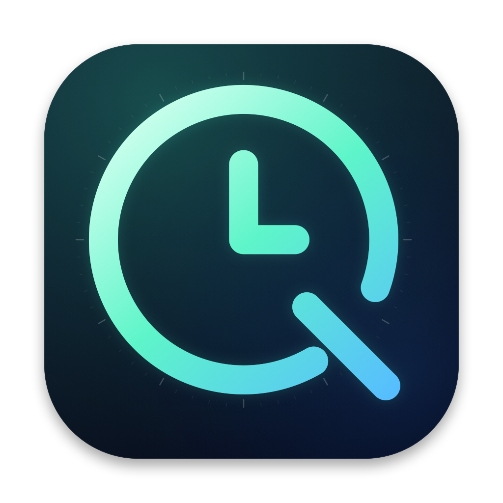
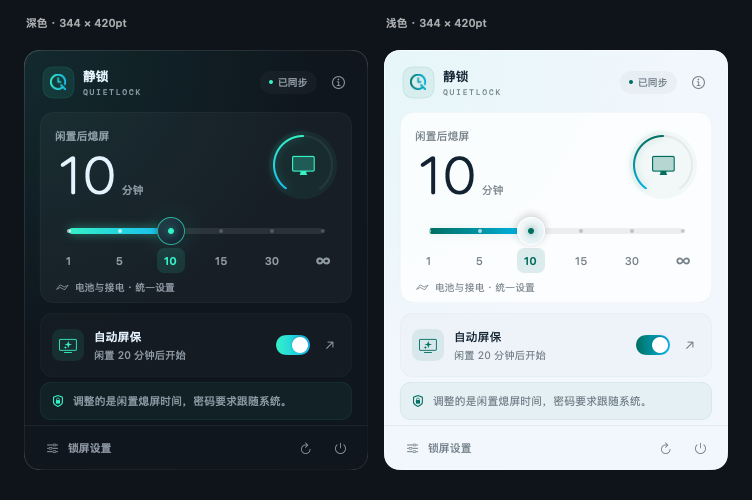
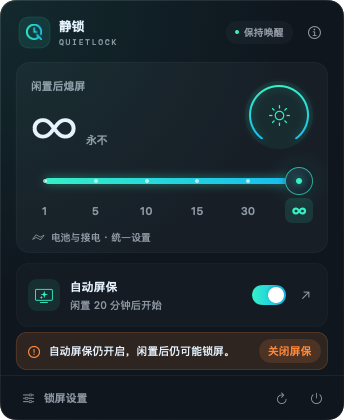
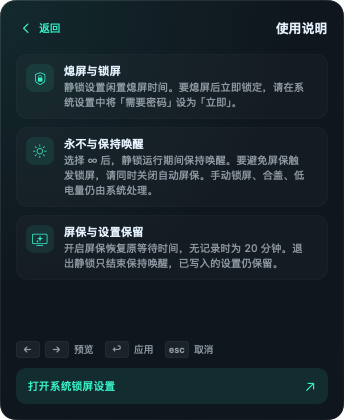

<div align="center">



# 静锁 QuietLock

**原生 macOS 菜单栏工具，一键掌控熄屏时间与自动屏保。**

在菜单栏用一个滑块设置闲置熄屏时间（1、5、10、15、30 分钟或永不），并快速开关闲置自动屏保。

[](https://github.com/tianguzhe/QuietLock/releases/latest)


[English](README.md) | **简体中文**

[**⬇ 下载最新版 DMG**](https://github.com/tianguzhe/QuietLock/releases/latest/download/QuietLock.dmg)



</div>

## 功能

- **六档滑块**：1、5、10、15、30 分钟或 ∞（永不）。拖动时实时预览并有触感刻度，也可直接点击刻度应用。
- **统一作用于所有电源**：电池、接电及受支持的 UPS 一并设置，写入后回读确认。
- **“永不”真正不熄屏**：选择 ∞ 后，静锁运行期间同时持有系统原生的保持唤醒断言。
- **自动屏保开关**：一键关闭闲置屏保，重新开启时恢复此前的等待时间。
- **醒目的风险提示**：选择“永不”但自动屏保仍可能锁屏时，面板会明确提示，并提供一键关闭。
- **始终与系统同步**：每 15 秒以及唤醒、解锁时重新读取实际设置；其他程序修改设置时如实提示，不会在后台强行覆盖。
- **每次启动只授权一次**：每次启动只弹一次管理员授权，退出前不再询问。
- **中英双语**：面板语言跟随系统首选语言，简体中文显示中文，其他语言显示英文。
- **原生且无障碍**：SwiftUI 实现，支持深浅色、“减少动态效果”“减少透明度”、完整键盘操作与 VoiceOver。
- **零依赖**：仅使用 Apple 系统框架，通用二进制同时支持 Apple Silicon 与 Intel。

## 截图

| “永不”时的屏保风险提示 | 内置使用说明 |
| :---: | :---: |
|  |  |

## 安装

1. 从[最新 Release](https://github.com/tianguzhe/QuietLock/releases/latest) 下载 [`QuietLock.dmg`](https://github.com/tianguzhe/QuietLock/releases/latest/download/QuietLock.dmg)，同时提供 `.sha256` 校验文件。
2. 打开磁盘映像，将 **QuietLock** 拖入 **Applications（应用程序）**。
3. 从“应用程序”打开静锁。应用只显示在菜单栏，没有 Dock 图标。

> [!NOTE]
> 发布版仅做了临时签名，未经 Apple 公证。首次打开时 macOS 可能拦截：右键点击应用选择**打开**，或在**系统设置 → 隐私与安全性**中点击**仍要打开**。

更新时请先退出正在运行的旧版，再拖入“应用程序”替换。

## 使用

1. 点击菜单栏中的 **Q** 时钟图标。
2. **首次设置**：点击面板底部的**锁屏设置**，在系统设置中将“屏幕保护程序启动或显示器关闭后，需要密码”设为**立即**。静锁控制的是*何时*熄屏，熄屏后是否需要密码由这项系统设置决定。
3. 拖动滑块后松手，或直接点击刻度。每次启动后的第一次修改需要输入管理员密码，本次运行期间之后的调整不再询问。
4. 想完全避免闲置锁屏，请选择 **∞**，*并*关闭**自动屏保**。屏保有独立的闲置定时，仍可能触发密码要求。

| 按键 | 作用 |
| --- | --- |
| <kbd>←</kbd> <kbd>→</kbd> | 预览上一档或下一档 |
| <kbd>Return</kbd> / <kbd>Space</kbd> | 应用预览的档位 |
| <kbd>Esc</kbd> | 取消预览 |

## 工作原理

| 控件 | 系统设置 | 说明 |
| --- | --- | --- |
| 时间滑块 | `pmset -a displaysleep <分钟>` | 作用于所有电源，写入后用 `pmset -g custom` 回读。 |
| ∞（永不） | `displaysleep 0` + IOKit `PreventUserIdleDisplaySleep` | 断言在静锁运行期间阻止屏幕和系统闲置睡眠，退出时释放。 |
| 自动屏保 | `com.apple.screensaver` 的 `idleTime`（当前用户、当前 Mac） | 写入 `0` 即关闭；保存此前的等待时间，重新开启时恢复（无记录时为 20 分钟）。写入后回读确认。 |

- 每次写入都会回读实际值确认。授权取消或只部分生效时，面板显示实际状态，不会报告成功。
- 其他程序或系统设置修改了熄屏时间时，静锁显示新值并停止保持唤醒，不会与之反复争抢。
- 退出静锁后设置保持不变，只有保持唤醒断言会结束。
- “永不”不会阻止手动锁屏、合盖、低电量睡眠或管理策略。受组织管理的屏保设置会显示为“由组织管理”，无法修改。

## 权限与安全

`pmset` 必须以 root 身份运行。静锁不会保存你的密码，也不会安装后台服务。

- **启动后的第一次修改**：弹出标准的 macOS 管理员授权（`do shell script … with administrator privileges`），在同一授权内完成修改，并安装 `/etc/sudoers.d/quietlock`。规则先经 `visudo -c` 校验，再以 `0440 root:wheel` 安装；校验失败时跳过规则，本次修改照常生效。
- **规则范围**：仅允许当前用户免密执行 7 条精确命令：`pmset -a displaysleep` 加 `1`、`5`、`10`、`15`、`30` 或 `0`，以及 `rm -f /etc/sudoers.d/quietlock`。其他命令一律不放行。用户名含空格、引号、逗号等不安全字符时，不安装规则。
- **之后的修改**：使用 `sudo -n`（从不询问密码）。规则若已被移除，静锁会重新请求授权。
- **撤销**：“已授权”只记在内存中，每次启动都会重新询问一次。退出静锁时（包括注销、关机）规则会自动删除；若因崩溃残留，下次启动时自动清理，也可手动执行 `sudo rm /etc/sudoers.d/quietlock`。

> [!IMPORTANT]
> 静锁运行期间（或崩溃后到下次启动前），本机以你的身份运行的任何程序，都能不输密码把熄屏时间改为这 6 个预设值之一。

## 从源码构建

需要 macOS 14 及以上、Xcode 15 及以上。无第三方依赖。

```sh
bash scripts/test.sh          # 单元测试（使用模拟服务，不修改本机设置）
bash scripts/build.sh         # 通用版应用 → .build/QuietLock.app（临时签名）
bash scripts/package-dmg.sh   # 拖动安装 DMG → dist/QuietLock.dmg + .sha256
bash scripts/preview.sh       # 渲染面板各状态 → .build/previews/{en,zh-Hans}/（需先运行 build.sh）
```

也可以用 Xcode 打开 `QuietLock.xcodeproj`，运行 **QuietLock** scheme。

- 单元测试使用模拟执行器和存储，另有两项只读检查会读取本机实际的 `pmset` 和屏保设置。
- `package-dmg.sh` 需要 Python 3.10+。首次运行会把固定版本的 `dmgbuild`、`ds-store`、`mac-alias` 安装到 `.build/dmg-venv/`，仅用于打包。已有最新的 `.build/QuietLock.app` 时，可加 `--skip-build` 跳过编译。
- 应用图标与菜单栏图标共用同一份矢量母版（`QuietLock/BrandMark.swift`），源文件更新后 `build.sh` 会自动重新生成 `AppIcon.icns`。

如需以自己的名义分发，请设置自己的 bundle identifier，使用 Developer ID 签名并完成公证。

## 发布

1. 修改 `QuietLock/Info.plist` 中的 `CFBundleShortVersionString` 并提交。
2. 运行 `bash scripts/release.sh`。

脚本会检查当前在 `main` 分支、工作区干净、版本 tag 尚不存在，接着运行测试，然后用一次原子推送同时推送 `main` 和 `v<版本>`。[发布工作流](.github/workflows/release.yml)在 `macos-26` runner 上核对 tag 与应用版本、运行测试、打包 DMG，并连同校验文件一起发布。某一步失败时，`scripts/ci-annotate.sh` 会把出错的行汇总成一条错误注解，不登录也能查看。

## 项目结构

```
QuietLock/                  SwiftUI 面板、AppKit 状态栏、无障碍滑块、品牌图标
Sources/QuietLockCore/      Swift Package：解析器、系统服务、状态模型
Tests/QuietLockCoreTests/   单元测试（不进行真实授权或写入）
Tools/                      图标、DMG 背景与预览渲染工具；dmgbuild 配置
scripts/                    测试、构建、打包、预览、发布与 CI 辅助脚本
.github/workflows/          tag 触发的发布流水线
docs/                       图标与截图（en/、zh-Hans/）
```

## 更新日志

- **1.4.2**：DMG 安装窗口与卷名改为英文。
- **1.4.1**：中英双语界面，跟随系统语言；应用名统一为 QuietLock。
- **1.4**：每次启动只需授权一次，退出时自动撤销。状态区改为醒目提示条，可一键关闭屏保。兼容字符串类型的 `idleTime`。打开面板时不再丢失外部改动提示。
- **1.3**：紧凑的固定尺寸面板（344 × 420 pt），内置使用说明。
- **1.2**：自动屏保开关；“永不”时原生保持唤醒；定时及唤醒时同步设置。
- **1.1**：原创 Q 时钟图标、冰川青玻璃风格与触感滑块。
